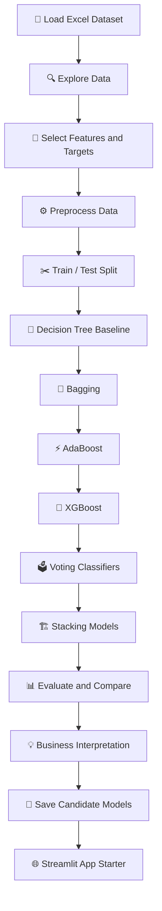
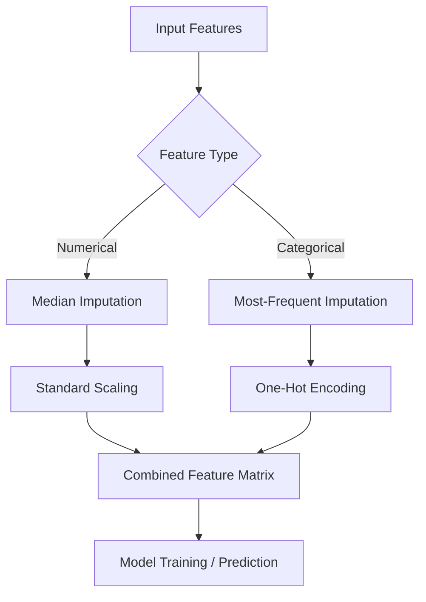
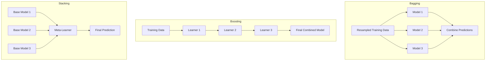
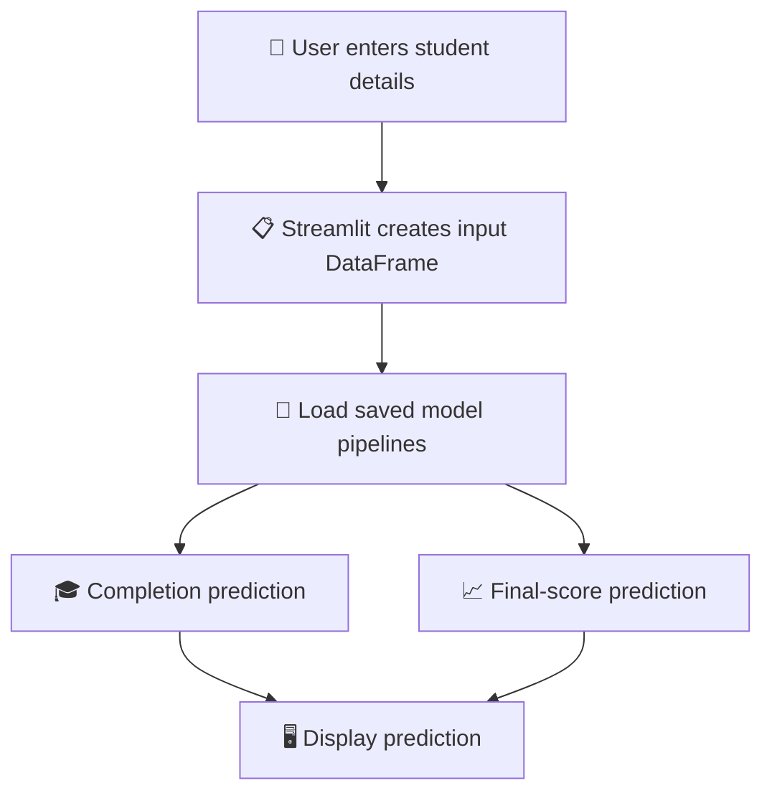

<div align="center">

# 🎓 Smart Outcome Predictor
### An Ensemble Machine Learning Project for Student Success Analytics

**Predicting online course completion and final student scores using ensemble learning**

<br/>


**Author: Dushyant V**

</div>

---

## 👋 About the Project

What if an online learning platform could identify students who may need extra support before they fall behind?

That is the question behind **Smart Outcome Predictor**. This project explores how student demographics, course information, learning activity, and assessment data can be used to estimate two outcomes:

1. **Course completion** — will a student complete the course?
2. **Final score** — what final score might a student achieve?

I approached this as a practical machine learning project for an EdTech analytics team. Rather than relying on a single algorithm, I trained and compared several ensemble methods to understand which approach performed best for each prediction task.

The project covers the complete notebook workflow: loading and exploring the data, preprocessing, training baseline and ensemble models, evaluating results, interpreting findings, and saving candidate models for a simple Streamlit application.

> 💡 **The main takeaway:** XGBoost was the leading classification candidate by F1-score, while Stacking achieved the lowest RMSE for regression on this notebook's held-out test set. The best model depends on the business objective and the metric being prioritised.

---

## 📚 Table of Contents

- [🎯 Project Objectives](#-project-objectives)
- [🧩 Business Problem](#-business-problem)
- [📦 Dataset Overview](#-dataset-overview)
- [🗺️ Project Workflow](#️-project-workflow)
- [🛠️ Tools and Technologies](#️-tools-and-technologies)
- [⚙️ Installation and Setup](#️-installation-and-setup)
- [▶️ How to Run the Project](#️-how-to-run-the-project)
- [🧹 Data Preparation](#-data-preparation)
- [🤖 Machine Learning Models](#-machine-learning-models)
- [📊 Evaluation Metrics](#-evaluation-metrics)
- [🏆 Results and Model Comparison](#-results-and-model-comparison)
- [🔍 Business Interpretation](#-business-interpretation)
- [💻 Example Code from the Notebook](#-example-code-from-the-notebook)
- [🌐 Streamlit Application](#-streamlit-application)
- [📁 Project Structure](#-project-structure)
- [⚠️ Limitations and Responsible Use](#️-limitations-and-responsible-use)
- [🚀 Possible Next Steps](#-possible-next-steps)
- [👨‍💻 Author](#-author)
- [📄 Project Notes](#-project-notes)

---

## 🎯 Project Objectives

The main objectives of this project are to:

- Understand and inspect a real-world-style student learning dataset.
- Prepare numerical and categorical features for machine learning.
- Build a baseline using Decision Tree models.
- Apply **Bagging**, **AdaBoost**, and **XGBoost**.
- Compare **Hard Voting** and **Soft Voting** classifiers.
- Build **Stacking** models for classification and regression.
- Evaluate the models using appropriate metrics.
- Visualise model performance and explain the findings.
- Save the selected model pipelines for reuse in a Streamlit application.

---

## 🧩 Business Problem

Online education providers collect a wide range of information about how learners interact with their courses. However, raw data alone does not automatically tell an organisation which learners may need help or what outcomes they might achieve.

This project explores two practical questions:

| Business question | Machine learning task | Target |
|---|---|---|
| Is a student likely to complete the course? | Binary classification | `completion_status` |
| What final score might a student achieve? | Regression | `final_score` |

### Why this could be useful

A well-validated prediction system could help an education team:

- Prioritise outreach to students who may be at risk of not completing a course.
- Identify patterns between engagement and learning outcomes.
- Plan additional academic support and tutoring resources.
- Estimate likely score ranges to support learning interventions.

**Important:** These predictions should support human decisions, not replace educators or determine a student's opportunities.

---

## 📦 Dataset Overview

The project uses the supplied Excel dataset:

`Smart_Outcome_Predictor_Dataset_5200.xlsx`

| Dataset detail | Value |
|---|---:|
| Records | 5,200 |
| Columns | 19 |
| Prediction tasks | 2 |
| Classification target | `completion_status` |
| Regression target | `final_score` |

### Dataset fields

| Field | Description / role |
|---|---|
| `student_id` | Student identifier; excluded from model features |
| `age` | Student age |
| `country_region` | Country or region category |
| `device_type` | Device used for learning |
| `education_background` | Education background category |
| `course_level` | Course difficulty level |
| `course_category` | Course subject/category |
| `course_start_date` | Course start date; excluded from model features |
| `week_of_year` | Week-of-year value |
| `sessions` | Number of learning sessions |
| `time_spent_hours` | Time spent learning, in hours |
| `videos_watched` | Number of videos watched |
| `quiz_attempts` | Number of quiz attempts |
| `assignments_submitted` | Number of assignments submitted |
| `forum_posts` | Number of forum posts |
| `avg_quiz_score` | Average quiz score |
| `attendance_rate` | Attendance rate |
| `completion_status` | Classification target: 0 = Not Completed, 1 = Completed |
| `final_score` | Regression target: final score from 0 to 100 |

### Target variables

- `completion_status`: a binary target where `0` represents **Not Completed** and `1` represents **Completed**.
- `final_score`: a numerical target representing the student's final score.

### Feature selection and leakage prevention

The notebook excludes the following columns from the input features:

- `student_id` — an identifier, not a general learning signal.
- `course_start_date` — the raw date is omitted to keep the exercise focused on the covered feature-preparation techniques.
- `completion_status` — the classification answer must not be provided as an input.
- `final_score` — the regression answer must not be provided as an input, and it is also excluded from classification features.

This is important because a model should not be given the answer it is supposed to predict.

---

## 🗺️ Project Workflow

The notebook follows a step-by-step machine learning workflow.



### Train–test split

The notebook uses an **80/20 train–test split** with `random_state=42`.

| Subset | Records | Purpose |
|---|---:|---|
| Training | 4,160 | Fit preprocessing and train models |
| Testing | 1,040 | Evaluate performance on held-out records |

The classification split uses stratification to preserve the completion/not-completion proportions. The same row indices are used for the regression target so both tasks are evaluated on the same held-out student records.

---

## 🛠️ Tools and Technologies

| Tool / library | How it is used |
|---|---|
| **Python** | Main programming language |
| **Jupyter Notebook** | Interactive project development and explanation |
| **pandas** | Loading and exploring the Excel dataset |
| **NumPy** | Numerical operations |
| **Matplotlib** | Charts and model visualisations |
| **scikit-learn** | Preprocessing, model training, splitting, pipelines, and evaluation |
| **XGBoost** | Gradient-boosting classification and regression |
| **Joblib** | Saving trained model pipelines |
| **Streamlit** | Creating a simple prediction interface |

---

## ⚙️ Installation and Setup

### 1. Clone the repository

```bash
git clone https://github.com/YOUR-USERNAME/Smart-Outcome-Predictor.git
cd Smart-Outcome-Predictor
```

Replace `YOUR-USERNAME` with your GitHub username and use your actual repository URL.

### 2. Create a virtual environment (recommended)

**Windows:**

```bash
python -m venv .venv
.venv\Scripts\activate
```

**macOS / Linux:**

```bash
python3 -m venv .venv
source .venv/bin/activate
```

### 3. Install the required libraries

```bash
pip install pandas numpy matplotlib scikit-learn xgboost openpyxl joblib jupyter streamlit
```

The notebook uses `openpyxl` to read the Excel workbook.

> 📌 For a reproducible submission, record the package versions from the environment in which the notebook was successfully run. A pinned `requirements.txt` can then be added to the repository.

---

## ▶️ How to Run the Project

1. Download or clone the repository.
2. Keep the Excel dataset in the same folder as the notebook.
3. Install the required packages.
4. Launch Jupyter Notebook:

```bash
jupyter notebook
```

5. Open `Smart_Outcome_Predictor_Project.ipynb`.
6. Select **Kernel → Restart & Run All**.
7. Confirm that every code cell completes without errors.
8. Review the result tables, charts, and written interpretations.

**Expected input file:**

```text
Smart_Outcome_Predictor_Dataset_5200.xlsx
```

The notebook's dataset-loading cell expects this filename in the working directory.

---

## 🧹 Data Preparation

Data preparation is an important part of this project because machine learning algorithms need features in a suitable format.

### Numerical features

The numerical preprocessing pipeline:

1. Fills missing values using the median.
2. Applies `StandardScaler` to standardise numerical features.

### Categorical features

The categorical preprocessing pipeline:

1. Fills missing values using the most frequent category.
2. Applies `OneHotEncoder(handle_unknown="ignore")`.

The transformations are combined using `ColumnTransformer` and placed inside scikit-learn `Pipeline` objects. This allows preprocessing to be fitted on the training data as part of model training and then reused consistently when making predictions.

### Preprocessing flow



---

## 🤖 Machine Learning Models

The notebook compares a single Decision Tree baseline with multiple ensemble approaches.

### 🌱 1. Decision Tree — Baseline

A Decision Tree provides a starting point for comparison. It learns decision rules from the training data. The notebook uses a maximum depth of 5 for the baseline classifier and regressor.

### 🧺 2. Bagging — Bootstrap Aggregating

Bagging trains multiple versions of a base estimator using resampled training data, then combines their predictions. In this project, the base estimators are Decision Trees, with 50 estimators.

**Why use it?** It can reduce the instability of an individual decision tree by combining several learners.

### ⚡ 3. AdaBoost

AdaBoost builds learners sequentially. Later learners give more attention to examples that earlier learners handled poorly.

**Why use it?** It provides a boosting approach that can improve performance by focusing on difficult training examples.

### 🚀 4. XGBoost

XGBoost is a gradient-boosting implementation with regularisation and efficient training options. The notebook uses 120 estimators, a maximum depth of 3, and a learning rate of 0.08.

**Why use it?** It provides a powerful boosting approach for both classification and regression.

### 🗳️ 5. Voting Classifiers

The notebook compares two voting strategies:

- **Hard Voting:** each base classifier votes for a class; the majority wins.
- **Soft Voting:** predicted class probabilities are averaged, and the class with the higher combined probability is selected.

The base classifiers are Decision Tree, Logistic Regression, and Gaussian Naive Bayes.

### 🏗️ 6. Stacking

Stacking combines multiple base learners using a second-level model called a **meta-learner**.

- Classification uses Logistic Regression as the final estimator.
- Regression uses Ridge Regression as the final estimator.
- The notebook uses 3-fold cross-validation inside the stacking estimators.

**Why use it?** Different models can capture different patterns. Stacking learns how to combine their predictions rather than using only a fixed voting rule.

### Ensemble learning at a glance



---

## 📊 Evaluation Metrics

The project uses different metrics for classification and regression because the two tasks have different goals.

### Classification metrics

| Metric | What it tells us | Preferred direction |
|---|---|---|
| Accuracy | Overall proportion of correct predictions | Higher |
| Precision | How many predicted positives were actually positive | Higher |
| Recall | How many actual positives were correctly identified | Higher |
| F1-score | Balance between precision and recall | Higher |
| ROC-AUC | How well the model separates the two classes across thresholds | Higher |

The notebook sorts the classification comparison by **F1-score**. This is the primary selection metric for the completion prediction candidate in this experiment.

### Regression metrics

| Metric | What it tells us | Preferred direction |
|---|---|---|
| MAE | Average absolute prediction error | Lower |
| RMSE | Error measure that penalises larger errors more strongly | Lower |
| R² | Proportion of target variation explained by the model | Closer to 1 |

The notebook sorts the regression comparison by **RMSE**. RMSE is expressed in final-score points because the target is a score from 0 to 100.

---

## 🏆 Results and Model Comparison

The following results are from the notebook's saved execution outputs, using the 80/20 split and `random_state=42`.

### Classification results

| Model | Accuracy | Precision | Recall | F1-score | ROC-AUC |
|---|---:|---:|---:|---:|---:|
| **XGBoost** | **0.7413** | 0.6785 | 0.5897 | **0.6310** | 0.7873 |
| Stacking | 0.7365 | 0.6790 | 0.5641 | 0.6162 | **0.7942** |
| Hard Voting | 0.7394 | **0.6951** | 0.5436 | 0.6101 | 0.7003 |
| Bagging | 0.7327 | 0.6761 | 0.5513 | 0.6073 | 0.7800 |
| Soft Voting | 0.7327 | 0.6783 | 0.5462 | 0.6051 | 0.7866 |
| AdaBoost | 0.7337 | 0.6817 | 0.5436 | 0.6049 | 0.7870 |
| Decision Tree (Baseline) | 0.7029 | 0.6588 | 0.4308 | 0.5209 | 0.7547 |

<details>
<summary>📌 Classification result interpretation</summary>

XGBoost achieved the highest F1-score in this comparison at **0.6310**, with accuracy of **74.13%**. This makes it the leading classification candidate when balancing precision and recall.

Stacking achieved a slightly higher ROC-AUC of **0.7942**, compared with XGBoost's **0.7873**. This shows why it is important to consider the metric that matches the business objective rather than selecting a model based on one number alone.

The baseline Decision Tree had an F1-score of **0.5209**, below the ensemble results in this experiment.

</details>

### Regression results

| Model | MAE | RMSE | R² |
|---|---:|---:|---:|
| **Stacking** | **8.0795** | **10.0360** | **0.4467** |
| XGBoost | 8.1426 | 10.1478 | 0.4343 |
| Bagging | 8.4062 | 10.4304 | 0.4024 |
| AdaBoost | 8.9199 | 10.9045 | 0.3468 |
| Decision Tree (Baseline) | 8.7746 | 10.9993 | 0.3354 |

<details>
<summary>📌 Regression result interpretation</summary>

Stacking achieved the lowest RMSE at approximately **10.036 points** and the lowest MAE at approximately **8.080 points**. It is therefore the leading regression candidate based on the notebook's selected metric.

Its R² score was approximately **0.447**, which means the model explains some, but not all, of the variation in final scores. There is still meaningful room for improvement.

</details>

### Model selection summary

| Prediction task | Leading candidate | Selection metric | Result |
|---|---|---|---:|
| Course completion | XGBoost | F1-score | 0.6310 |
| Final score | Stacking | RMSE | 10.0360 |

> ⚠️ **Evaluation note:** The notebook calculates ROC-AUC using predicted probabilities where available. Hard Voting does not provide class probabilities in this implementation, so its ROC-AUC is calculated from predicted class labels and is a coarse estimate. It should not be interpreted as directly equivalent in quality to probability-based ROC-AUC values.

---

## 🔍 Business Interpretation

The results suggest two different candidate models for the two business questions.

### Course completion

XGBoost is the leading candidate by F1-score. An EdTech team could investigate whether a model like this can help identify learners who may benefit from additional support.

The confusion matrix and classification report are important here. In the notebook's XGBoost classification report, recall for the **Completed** class is approximately 0.59. This means the model does not identify every student who completes the course. The cost of false positives and false negatives should be considered before choosing a deployment threshold.

### Final score

Stacking is the leading candidate by RMSE. Its average absolute error is approximately 8.08 score points, while its RMSE is approximately 10.04 points.

This could be useful for estimating likely performance, but the model should not be treated as an exact forecast for an individual learner.

### Recommendation

For this experiment, I would carry forward:

- **XGBoost** for further validation of course-completion predictions.
- **Stacking** for further validation of final-score predictions.

Before real-world use, I would test both models on a newer cohort, investigate performance across relevant student groups, review the consequences of prediction errors, and monitor performance after deployment.

---

## 💻 Example Code from the Notebook

The following examples show the main techniques used in the project. They are representative extracts from the notebook, not a replacement for running the complete notebook.

### 1. Load the dataset

```python
import pandas as pd

DATA_FILE = "Smart_Outcome_Predictor_Dataset_5200.xlsx"

df = pd.read_excel(DATA_FILE)

print(f"Dataset loaded: {df.shape[0]:,} rows and {df.shape[1]} columns")
display(df.head())
```

### 2. Separate features and targets

```python
TARGET_CLASS = "completion_status"
TARGET_REG = "final_score"

drop_from_features = [
    "student_id",
    "course_start_date",
    TARGET_CLASS,
    TARGET_REG
]

X = df.drop(columns=drop_from_features)
y_class = df[TARGET_CLASS].astype(int)
y_reg = df[TARGET_REG].astype(float)
```

### 3. Create preprocessing pipelines

```python
from sklearn.pipeline import Pipeline
from sklearn.impute import SimpleImputer
from sklearn.preprocessing import StandardScaler, OneHotEncoder
from sklearn.compose import ColumnTransformer

numeric_transformer = Pipeline(steps=[
    ("imputer", SimpleImputer(strategy="median")),
    ("scaler", StandardScaler())
])

categorical_transformer = Pipeline(steps=[
    ("imputer", SimpleImputer(strategy="most_frequent")),
    ("onehot", OneHotEncoder(handle_unknown="ignore"))
])

preprocessor = ColumnTransformer(transformers=[
    ("num", numeric_transformer, numeric_features),
    ("cat", categorical_transformer, categorical_features)
])
```

### 4. Train an XGBoost classifier

```python
from xgboost import XGBClassifier

xgb_classifier = Pipeline(steps=[
    ("preprocessor", preprocessor),
    ("model", XGBClassifier(
        n_estimators=120,
        max_depth=3,
        learning_rate=0.08,
        subsample=0.9,
        colsample_bytree=0.9,
        objective="binary:logistic",
        eval_metric="logloss",
        random_state=42,
        n_jobs=1
    ))
])

xgb_classifier.fit(X_train, y_class_train)
```

### 5. Evaluate a classification model

```python
from sklearn.metrics import (
    accuracy_score,
    precision_score,
    recall_score,
    f1_score
)

predictions = xgb_classifier.predict(X_test)

print("Accuracy:", accuracy_score(y_class_test, predictions))
print("Precision:", precision_score(y_class_test, predictions))
print("Recall:", recall_score(y_class_test, predictions))
print("F1-score:", f1_score(y_class_test, predictions))
```

### 6. Save the selected model pipelines

```python
import joblib

joblib.dump(best_classifier, "best_completion_model.joblib")
joblib.dump(best_regressor, "best_final_score_model.joblib")
```

---

## 🌐 Streamlit Application

The notebook includes a final section that writes a starter Streamlit application file named `streamlit_app.py`.

The intended interface allows a user to enter student details such as age, region, device type, course information, engagement activity, quiz performance, and attendance rate. The application loads the saved model pipelines and displays predictions when the user selects the prediction button.

### Run the application locally

First, make sure the notebook has been run successfully and that the two model files have been saved.

```bash
streamlit run streamlit_app.py
```

The application is a **starter interface** generated by the notebook. Creating the file does not automatically deploy it online. Before sharing a live application, test it locally, confirm that its input fields match the training features, and deploy it using a hosting service.

### Application flow



---

## 📁 Project Structure

A suggested repository layout for the project is:

```text
Smart-Outcome-Predictor/
│
├── Smart_Outcome_Predictor_Project.ipynb
├── Smart_Outcome_Predictor_Dataset_5200.xlsx
├── streamlit_app.py
│
├── best_completion_model.joblib
├── best_final_score_model.joblib
│
├── README.md
├── requirements.txt
│
├── assets/
│   ├── classification_results.png
│   ├── regression_results.png
│   ├── confusion_matrix.png
│   └── actual_vs_predicted.png
│
└── presentation/
    └── project_video_link.txt
```

The notebook creates the model files and Streamlit starter file when the relevant cells are executed. The `assets/`, `requirements.txt`, and `presentation/` items are suggested organisation for a polished repository; include them when you have created the corresponding files.

---

## ⚠️ Limitations and Responsible Use

I would not describe this project as production-ready yet. A few limitations are important:

1. **Held-out test evaluation:** The reported metrics come from one 80/20 split. They may change with a different split or a new student cohort.
2. **Regression performance:** The Stacking R² score is approximately 0.447, so a substantial amount of final-score variation remains unexplained.
3. **Classification trade-offs:** Precision and recall are not perfect. The business should decide which type of prediction error is more costly before selecting a threshold.
4. **Fairness:** Student predictions should be reviewed for differences in performance across relevant groups.
5. **Data quality and drift:** The model should be re-evaluated if course design, student behaviour, or data collection changes.
6. **Human oversight:** Predictions should be used to offer support, not to restrict access, label students, or make high-impact decisions automatically.
7. **Application validation:** The Streamlit starter should be tested with valid and edge-case inputs before it is shared as a live tool.

---

## 🚀 Possible Next Steps

The next stage of this project would be to:

- Validate performance using cross-validation and a newer student cohort.
- Tune model hyperparameters using a controlled validation process.
- Review class-specific precision and recall and choose an appropriate intervention threshold.
- Compare performance across relevant student groups.
- Improve the Streamlit interface with input validation and clearer explanations.
- Add automated tests and a reproducible environment file.
- Deploy the application only after end-to-end testing and responsible-use review.

---

## 👨‍💻 Author

**Dushyant V**  
Machine Learning & Data Science Learner | Aspiring Data / Machine Learning Professional

I built this project to practise the end-to-end machine learning workflow: understanding a business problem, preparing data, training and comparing models, evaluating performance, and communicating findings in a practical way.

I'm particularly interested in applying data science and machine learning to problems where analysis can help people make better-informed decisions.

---

## 📄 Project Notes

- **Project:** Smart Outcome Predictor
- **Focus:** Ensemble Learning — Classification and Regression
- **Dataset:** Supplied 5,200-record student dataset
- **Notebook:** `Smart_Outcome_Predictor_Project.ipynb`
- **Author:** Dushyant V

This is an educational portfolio project. The metrics shown in this README reflect the notebook's recorded run and should be regenerated if the dataset, code, library versions, or experiment settings change.

<div align="center">

### ⭐ Thanks for taking the time to explore my project!

*Built with curiosity, practical learning, and a focus on turning data into useful insights.*

</div>
